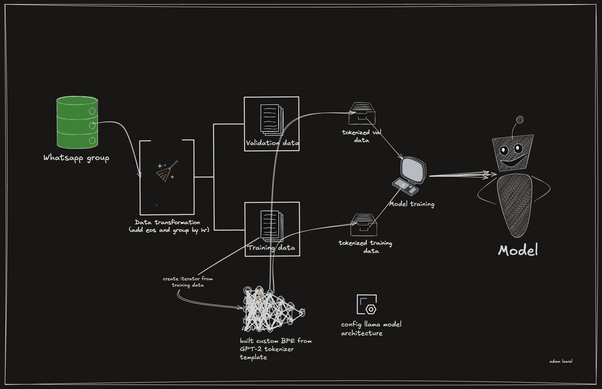

# Friendlies

My friends talk a lot and I thought it'd be cool to learn about causal language modeling by building a small CLM that talks just like them. I trained the model from scratch on a cleaned WhatsApp group chat to speak like my colleagues.

## System design




## What it does

- A custom byte-level BPE tokenizer (~8k vocab) from the GPT-2 template
- Tiny Llama-style decoder architecture 
- Messages grouped by speaker and hour, with a per-person train/val split
- Generate with prompts like `Koded:` or `Adam:` or any of your friends names if you try it out 🗣️

Chat exports and model weights stay local and uncommitted. 

## Layout

```
data/           # chat exports + cleaned CSV (gitignored)
notebooks/      # preprocessing + training
src/            # reusable code (as needed)
models/         # tokenizer + checkpoints (gitignored)
environment.yml
```

## Setup

```bash
conda env create -f environment.yml
conda activate friendlies
```

Then install training deps if needed:

```bash
pip install torch transformers datasets accelerate
```

## Notebooks

1. `notebooks/preprocessing.ipynb` — parse WhatsApp export, clean messages
2. `notebooks/training.ipynb` — format conversations, tokenizer, train, generate
